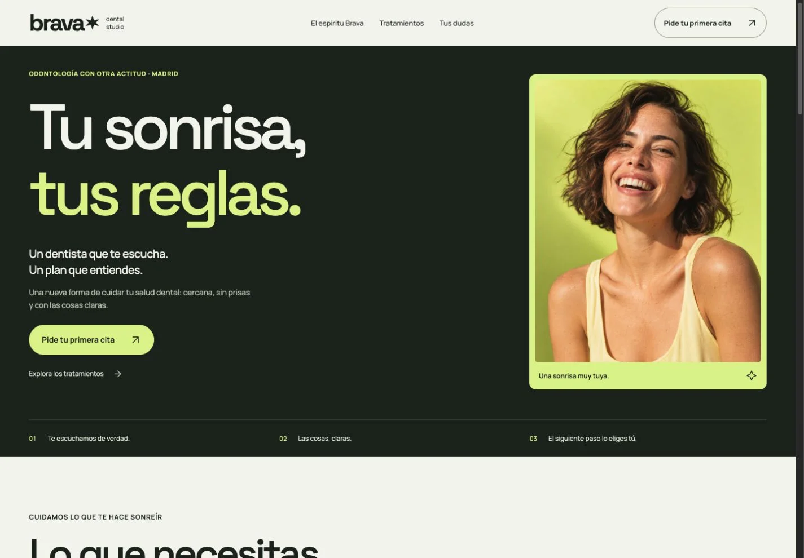

# BRAVA Dental Studio

**Una clínica ficticia. Un ejercicio real de diseño y desarrollo frontend.**

Landing editorial que explora cómo transmitir cercanía y personalidad en un sector que suele recurrir a interfaces convencionales. Desarrollada con Astro, TypeScript y CSS, con fotografía completa, interacción ligera y atención al detalle en formularios.

[Ver demo](https://arcas0803.github.io/brava-dental/) · [Leer el caso de estudio](https://arcas0803.github.io/brava-dental/caso-de-estudio/) · [Decisiones del proyecto](docs/CASE_STUDY.md)



## El proyecto

El reto era crear una landing contemporánea y expresiva sin comprometer la claridad de lectura, la fotografía ni la facilidad para solicitar una cita. La dirección combina tinta verde, lima, titulares amplios y una composición de tratamientos asimétrica.

| Área | Implementación |
|---|---|
| Diseño | Sistema visual propio, tipografía local y responsive de 320 a 1920 px |
| Desarrollo | Astro estático, TypeScript y CSS; sin hidratación de frameworks de interfaz |
| Interacción | Menú móvil, FAQ nativa y selección de tratamiento integrada con el formulario |
| Formulario | Validación inline, espacio reservado para errores y gestión del foco |
| Publicación | GitHub Pages con despliegue automatizado mediante GitHub Actions |
| Calidad | Revisión visual y análisis de rendimiento y buenas prácticas |

## Resultados de la publicación

| Lighthouse · tres ejecuciones por perfil | Móvil | Escritorio |
|---|---|---|
| Rendimiento | 100 | 100 |
| Buenas prácticas | 100 | 100 |
| Accesibilidad automatizada | 100 | 100 |
| LCP mediano | 1,51 s | 0,33 s |

Evaluación del 13/10/2026 sobre la landing publicada. Son métricas de laboratorio, no garantías de experiencia para todo usuario ni certificación WCAG. [Método, rangos y limitaciones](docs/PERFORMANCE.md).

## Decisiones que importan

- **La foto conserva su proporción.** No se recorta el rostro ni se sitúa texto sobre la imagen.
- **Los errores tienen su propio espacio.** La validación no desplaza los campos o el siguiente control.
- **El foco forma parte del campo.** Borde de contraste y halo suave, manteniendo una señal visible al navegar con teclado.
- **HTML antes que JavaScript.** La estructura y el contenido se entregan como HTML; la FAQ usa `details` y `summary`.
- **Una demo honesta.** Sin opiniones, credenciales ni cifras clínicas inventadas. El formulario no reserva citas ni transmite datos.

## Ejecutarlo

Node.js 24 recomendado. Dependencias fijadas mediante `package-lock.json`.

```sh
npm ci
npm run dev
npm run check
npm run build
npm run preview
```

Para probar una publicación bajo un subdirectorio:

```sh
ASTRO_SITE=https://arcas0803.github.io ASTRO_BASE=/brava-dental npm run build
```

Las imágenes, el favicon, las fuentes y las páginas respetan el prefijo del repositorio. El workflow obtiene la URL y el subdirectorio de GitHub Pages.

## Rendimiento y buenas prácticas

[Informe de la publicación](docs/PERFORMANCE.md). Las mediciones de laboratorio se identifican por URL, fecha, perfil y número de ejecuciones. No se presentan como datos de usuarios reales ni como una certificación de accesibilidad.

## Alcance

BRAVA es una marca y clínica ficticias. El formulario solo demuestra un recorrido en el navegador, sin backend ni almacenamiento. La página mantiene `noindex, follow` para evitar presentarla en buscadores como un negocio real; esto reduce intencionadamente la puntuación SEO de Lighthouse.

La fotografía de campaña fue generada para este concepto. La fotografía del espacio procede de [Unsplash](https://unsplash.com/) y se utiliza como referencia visual; no representa una clínica BRAVA real. Las fuentes Space Grotesk y Manrope se distribuyen mediante Fontsource bajo sus respectivas licencias OFL.

## Autor

[Álvaro Arcas · GitHub](https://github.com/arcas0803)
